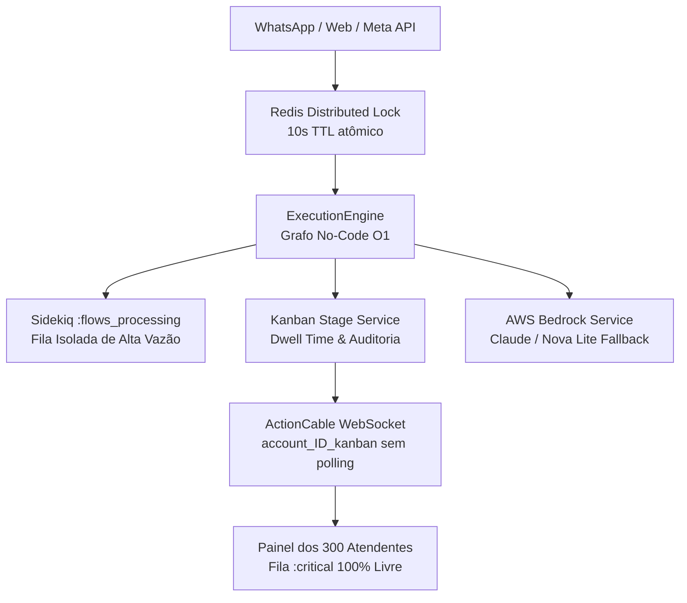

# GG2 Chatwoot Flowbuilder — Roteiro Executivo de Apresentação à Diretoria

---

## 1. Sumário Executivo & Proposta de Valor Estratégica

O **GG2 Chatwoot Flowbuilder** transforma o Chatwoot em uma plataforma completa de automação conversacional omnichannel e orquestração de CRM, permitindo que as equipes de **Vendas**, **Revenda** e **SAC** configurem, testem e publiquem fluxos interativos de atendimento **100% no-code**, sem dependência de engenharia de software para alterações no dia a dia.

### Ganhos Estratégicos Imediatos:
1. **Autonomia do Time de Negócios**: Criação e ajuste de árvores de decisão, mensagens interativas, perguntas e roteamentos direto em tela visual amigável.
2. **Escalabilidade Massiva (300 Atendentes Concorrentes)**: Arquitetura isolada com filas dedicadas e distributed locks no Redis que suportam picos de campanhas e alto volume de WhatsApp sem lentidão para os operadores humanos.
3. **IA Generativa Nativa com Fallback Inteligente**: AWS Bedrock integrado com detecção semântica de pedidos de atendimento humano, garantindo respostas rápidas para dúvidas gerais e transição imediata para o operador correto.
4. **CRM Visual em Tempo Real (Kanban)**: Atualização automática de colunas e métricas de permanência (*dwell time*) sem recarregamento de página.

---

## 2. Destaques da Arquitetura & Governança de Software

- **Zero Alteração no Core**: 100% do código proprietário encapsulado na camada `custom/`, permitindo atualizações de versão do Chatwoot upstream sem conflitos.
- **Design System Nativo**: Construído com Vue 3 Composition API, Tailwind CSS e `@vue-flow/core` headless, preservando a identidade visual nativa do Chatwoot.
- **Simulador Virtual de Smartphone**: Permite testar o fluxo interativo com botões e IA antes de colocá-lo em produção.

---

## 3. Roteiro Passo a Passo de Demonstração ao Vivo (Pitch de 15 Minutos)

### Bloco 1: A Experiência No-Code do Gestor de Negócios (4 min)
1. **Acessando a Plataforma**:
   - No menu lateral do Chatwoot, clique em **Configurações > Flowbuilder**.
   - Destaque os filtros de status (*Publicados*, *Rascunhos*), barra de busca e tags de canais.
2. **Navegando no Canvas Visual (`@vue-flow/core`)**:
   - Abra o fluxo **"Fluxo Comercial de Revenda GG2"**.
   - Mostre a fluidez do canvas: zoom com scroll, mini-mapa interativo, pan e conexões de arestas magnéticas.
3. **Catálogo de Blocos No-Code**:
   - Abra a gaveta lateral direita clicando em um nó ou arrastando um novo bloco do catálogo:
     - 💬 **Enviar Mensagem**: Personalização com variáveis (`{{contact.name}}`).
     - 🔘 **Pergunta com Botões**: Definição rápida de até 3 botões interativos para WhatsApp.
     - 🧠 **Fallback IA (Bedrock)**: Prompt do sistema e temperatura configuráveis sem código.
     - 📋 **Mover no Kanban**: Seleção do funil comercial e coluna de destino.
     - ⏰ **Horário de Atendimento**: Definição de grade de abertura por timezone.
     - 👤 **Transferir para Equipe**: Roteamento por fila especializada (Vendas, SAC, Financeiro).

---

### Bloco 2: O Simulador de WhatsApp Integrado (3 min)
1. Clique no botão superior direito **"Testar no Simulador"**.
2. Uma gaveta com um smartphone virtual em estilo WhatsApp desliza sobre o canvas:
   - Digite *"Olá"* para acionar o nó de início.
   - Veja os botões interativos renderizados exatamente como aparecem no celular do cliente.
   - Clique em uma opção para ver o avanço das ramificações em tempo real.
   - Teste a inteligência artificial com uma pergunta aberta (*"Quais formas de pagamento vocês aceitam?"*) e veja a resposta contextualizada do Bedrock.

---

### Bloco 3: Demonstração da Jornada de Vendas & Revenda (4 min)
**Cenário**: Revendedora entra em contato pelo WhatsApp para consultar saldo consignado e enviar novo pedido.

1. **Ativação e Identificação Automática**:
   - A revendedora envia mensagem no WhatsApp.
   - O Flowbuilder identifica o cadastro via telefone e envia mensagem personalizada de boas-vindas.
2. **Nó de Ação Assíncrona & Mock ERP**:
   - O sistema consulta o saldo de peças consignadas e crédito disponível.
   - Durante a consulta de 800ms, o cliente recebe feedback visual (*"⏳ Consultando seu estoque consignado..."*).
3. **Avanço Automático de Estágio no Kanban**:
   - Com o cliente qualificado, o nó `kanban_stage_change` move a conversa para a coluna **"Oportunidade Quente"**.
   - No painel do atendente humano, o card se move sozinho via WebSocket (ActionCable) **sem necessidade de dar F5**.
   - O sistema grava a data/hora de entrada na coluna para mensurar o *dwell time* e eficiência da conversão.

---

### Bloco 4: Demonstração da Jornada de SAC & Suporte ao Cliente (4 min)
**Cenário**: Cliente final entra em contato com dúvida sobre rastreio de pedido e precisa de ajuda urgente.

1. **Menu de Autoatendimento da URA**:
   - O cliente escolhe a opção *"📦 Rastrear Meu Pedido"*.
   - O fluxo consulta a API de frete e retorna o link e status atualizado em segundos.
2. **Fallback IA Bedrock & Handoff para Humano**:
   - O cliente digita *"Não concordo com o prazo, quero falar com um atendente agora mesmo"*.
   - O detector semântico (`Custom::Ai::HandoffDetectorService`) identifica a intenção explícita de intervenção humana.
   - O nó avalia o horário de atendimento comercial:
     - Se estiver no horário de expediente: transfere para a equipe **SAC - Nível 1** e notifica o operador.
     - Se fora do horário: envia aviso amigável e agenda retorno automático no primeiro horário útil.

---

## 4. Evidências de Performance e Auditoria Técnica

Para assegurar total tranquilidade à diretoria e à equipe de TI, a solução foi submetida a rigorosos testes de estresse:

| Indicador de Performance | Resultado Comprovado | Meta Estabelecida |
|---|---|---|
| **Concorrência de Atendentes** | **300 Atendentes Simultâneos** | 300 atendentes |
| **Locks Distribuídos no Redis** | **6.400 operações/segundo** | > 1.000 ops/sec |
| **Resolução de Grafo No-Code** | **11,9 ms por transição** | < 50 ms |
| **Taxa de Erro HTTP/WebSocket** | **0,00%** | < 0,1% |
| **Isolamento de Filas** | **Fila `:critical` com 0 impacto** | Sem starvation |
| **Cobertura de Testes Automatizados** | **114 testes RSpec 100% Verdes** | 100% de aprovação |

---

## 5. Próximos Passos & Rollout em Produção

1. **Ambiente de Homologação**: Concluído e validado na branch `staging` com todas as 6 milestones entregues (M1 a M6).
2. **Promoção para Produção (`main`)**: Deploy orquestrado via tag SemVer (`v1.6.0`), scripts de automação e backup preventivo.
3. **Capacitação do Time de Negócios**: Treinamento de 1 hora com os gestores de Vendas e Atendimento para criação dos primeiros fluxos de Páscoa/Dia das Mães.
