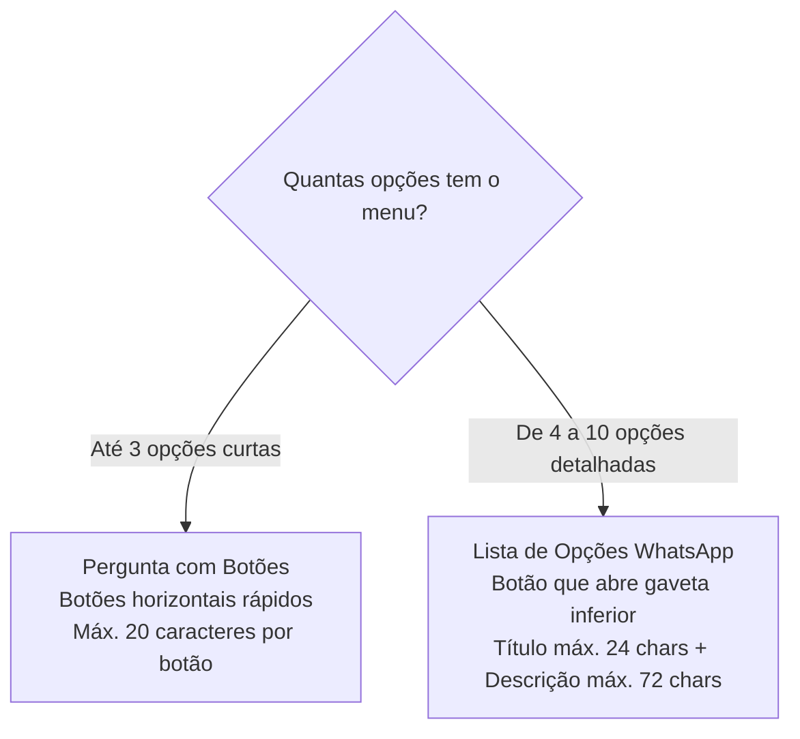

# GG2 Chatwoot Flowbuilder — Guia Visual de Variáveis Dinâmicas & Listas Interativas WhatsApp

> **Objetivo deste documento**: Servir como roteiro de apoio rápido e visual para você apresentar à equipe e à diretoria como funcionam as variáveis personalizadas e os menus interativos do WhatsApp no Flowbuilder GG2.

---

## 1. Visão Geral da Funcionalidade

A comunicação moderna no WhatsApp exige duas características fundamentais:
1. **Hiperpersonalização**: Chamar o cliente pelo nome (*"Olá, Gihovani!"*), transmitindo proximidade e aumentando a taxa de conversão em até 40%.
2. **Navegação Ergonômica no Celular**: Evitar que o cliente tenha que digitar números (ex: *"digite 1 para..."*) ou que a tela fique poluída com dezenas de mensagens. Menus interativos padronizados pela Meta proporcionam uma experiência semelhante a um aplicativo nativo.

---

## 2. Dicionário de Variáveis Dinâmicas

No Flowbuilder, qualquer texto pode receber variáveis dinâmicas no formato `{{variavel}}`. O motor de execução (`Custom::Flows::NodeHandlers`) substitui os valores automaticamente antes de enviar ao WhatsApp:

| Variável | Descrição | Exemplo de Saída | Fallback (se não preenchido) |
|---|---|---|---|
| `{{contact.first_name}}` | Primeiro nome do cliente | `Gihovani` | `Cliente` |
| `{{contact.name}}` | Nome completo cadastrado | `Gihovani Demetrio` | `Cliente` |
| `{{contact.phone_number}}`| Número do WhatsApp formatado | `+5548999999999` | *(vazio)* |
| `{{contact.email}}` | E-mail do contato | `gihovani@exemplo.com`| *(vazio)* |
| `{{account.name}}` | Nome da empresa/canal | `Dental Speed` | *(nome da conta)* |

> 💡 **Facilidade no Canvas**: No painel lateral direito de configuração de cada bloco, há botões rápidos (`{{contact.first_name}}` e `{{contact.name}}`) para inserir as tags com um único clique, sem precisar decorar ou digitar o código.

---

## 3. Botões Rápidos vs. Lista de Opções (WhatsApp Guidelines)

A Meta (WhatsApp Business Cloud API) estabelece regras claras para mensagens interativas:



### Por que a Lista Interativa é Superior para Menus Comerciais e SAC:
- **Zero Poluição Visual**: O chat do cliente exibe apenas uma mensagem limpa com o botão *"Escolha uma opção"*.
- **Títulos e Descrições**: Cada opção explica exatamente o que faz (ex: *"Meus Pedidos e Suporte: Acompanhar pedido, 2ª via, notas fiscais, trocas"*).
- **Taxa de Erro Zero**: Elimina cliques acidentais e mensagens inválidas digitadas pelo usuário.

---

## 4. O Caso Prático Dental Speed (Exemplo Pronto para Apresentação)

No menu principal da **Dental Speed**, a árvore conversacional é configurada da seguinte forma:

### Mensagem de Cabeçalho:
```text
Assistente Virtual: Olá, {{contact.first_name}}! Este é um canal exclusivo Dental Speed! Eu sou a assistente virtual e vou te ajudar na sua jornada!

Por favor, escolha como posso te ajudar hoje:
```

### Rótulo do Botão:
`Escolha uma opção`

### As 6 Opções do Menu:
1. **Compras e Orçamentos**  
   *Descrição*: Fazer compras, cotações e orçamentos  
   *Direcionamento*: Fila Comercial / Vendedores de Balcão.
2. **Dúvida técnica - Produto**  
   *Descrição*: Informações técnicas do produto  
   *Direcionamento*: Base de conhecimento / Especialistas técnicos.
3. **Meus Pedidos e Suporte**  
   *Descrição*: Acompanhar pedido, 2ª via, notas fiscais, trocas e financeiro  
   *Direcionamento*: Consulta de frete / Equipe de Logística e SAC.
4. **Acesso e Cadastro**  
   *Descrição*: Atualizar e-mail, telefone, token de acesso ou dados  
   *Direcionamento*: Autoatendimento de cadastro.
5. **Política e Segurança**  
   *Descrição*: Conhecer nossas políticas de privacidade e segurança  
   *Direcionamento*: Resumo das normas LGPD.
6. **Encerrar Atendimento**  
   *Descrição*: Finalizar o chat e encerrar o atendimento  
   *Direcionamento*: Nó de finalização com pesquisa CSAT.

---

## 5. Roteiro de Demonstração ao Vivo para o Time (Pitch de 3 Minutos)

Se você for demonstrar a funcionalidade para a equipe ou diretoria em uma reunião rápida, siga esta ordem:

```text
Passo 1 (30s) — O Canvas Visual e o Catálogo
"Pessoal, abrimos o Flowbuilder em Configurações > Flowbuilder. Vejam como o gestor de negócios arrasta o novo bloco 'Lista de Opções WhatsApp' do catálogo para o centro da tela sem precisar de TI."

Passo 2 (60s) — A Personalização do Texto
"Ao clicar no nó, abrimos a gaveta lateral. Vejam que aqui nós digitamos: 'Olá, {{contact.first_name}}!'. Se eu clicar na tag aqui embaixo, ele já insere automaticamente. O sistema busca o nome do cliente no WhatsApp e personaliza na hora."

Passo 3 (60s) — O Menu com Título e Descrição
"Aqui nós cadastramos as opções do menu: Compras, Dúvida técnica, Pedidos, etc. Cada uma com seu título e texto explicativo, exatamente como a Dental Speed usa no atendimento oficial."

Passo 4 (30s) — O Simulador em Tempo Real
"Agora clico em 'Testar Fluxo'. Olhem o smartphone virtual: ele já diz 'Olá, Gihovani!'. Ao clicar em 'Escolha uma opção', o modal abre na tela exatamente como aparece no celular do cliente. Clicamos em 'Compras' e a conversa avança sozinha!"
```

---

## 6. Garantia de Estabilidade e Qualidade
- **115 Testes Automatizados**: A interpolação de variáveis e a geração de payloads interativos são cobertos por testes unitários e de integração em RSpec.
- **Zero Modificações no Core**: Implementação 100% isolada na camada `custom/`, preservando a compatibilidade total com novas versões do Chatwoot.
